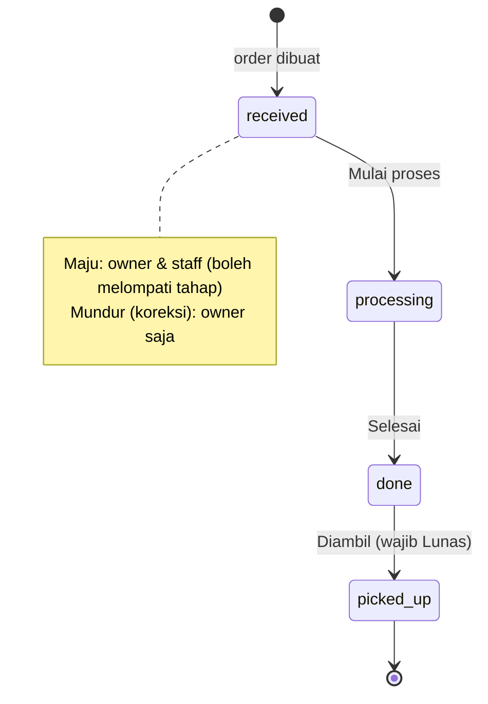

# Jesi Laundry App — Arsitektur Sistem

> Dokumen induk untuk Claude Code. Baca dokumen ini sampai selesai sebelum membuka `server/BACKEND.md` dan `client/FRONTEND.md`.
> Jika ada konflik antar dokumen, dokumen ini yang berlaku.

---

## 1. Ringkasan Produk

Aplikasi mobile internal (Android & iOS) untuk mencatat cucian masuk harian di usaha laundry **Jesi Laundry**, lalu menyajikannya dalam dashboard dan grafik.

Fitur inti:

- Autentikasi email + password untuk dua peran, **Owner** dan **Staff**, termasuk lupa password via OTP 6 digit lewat email.
- Input order laundry:
  - **Kiloan**: Cuci Setrika, Setrika saja, Cuci Lipat (minimal 3 kg, di bawah itu ditagih 3 kg).
  - **Satuan**: per pcs (bed cover, boneka, dll) atau per m² (karpet, input panjang × lebar).
  - Semua layanan punya kecepatan **Reguler** (default 3 hari) dan **Express** (default 1 hari).
- Tracking status order dan status pembayaran.
- Pelanggan tersimpan otomatis dan muncul di autocomplete saat order berikutnya.
- Dashboard + grafik untuk 1 jam, 24 jam, 7 hari, 30 hari, 1 tahun terakhir, dan seluruh waktu; dikategorikan per jenis layanan dan per jenis satuan.
- Owner mengelola harga, durasi, minimum, jenis satuan (tambah / nonaktifkan / hapus), staff, dan outlet.
- Bahasa Indonesia & Inggris; tema terang, gelap, dan ikut sistem.

Saat ini hanya 1 outlet, tetapi skema data sudah mendukung banyak outlet (§6).

---

## 2. Prinsip Arsitektur (WAJIB)

1. **Modular monolith.** Satu service backend, satu database, satu aplikasi mobile. Modul dipisah per domain di dalam satu codebase. Tidak ada microservice, message queue, Redis, background worker, atau event bus.
2. **Tidak over-engineering.** Tanpa DI framework, tanpa clean architecture berlapis (usecase / entity / domain terpisah), tanpa generic repository, tanpa code generation selain `gen-l10n` bawaan Flutter. Interface hanya dibuat untuk memutus dependency antar modul atau bila ada >1 implementasi nyata (contoh: `Mailer`).
3. **Server adalah sumber kebenaran.** Harga, minimum, total, estimasi selesai, nomor order, dan hak akses dihitung & divalidasi di server. Client boleh menampilkan pratinjau, tetapi nilai yang tersimpan selalu hasil hitungan server.
4. **Satu model / entitas per file**, di backend maupun mobile.
5. **Migrasi database dalam satu file** (GORM AutoMigrate). Raw SQL dihindari; satu-satunya pengecualian adalah ekspresi agregasi waktu di dashboard (lihat BACKEND.md §11).
6. **Tidak ada file test.** Jangan membuat `*_test.go`, folder `test/`, atau `integration_test/`. Hapus `test/widget_test.dart` bawaan `flutter create` dan dependency `flutter_test`. Pengujian dilakukan manual oleh pemilik proyek.
7. **Dependency minimal.** Hanya gunakan dependency yang tercantum di BACKEND.md / FRONTEND.md. Jika benar-benar butuh package baru, tulis alasannya di ringkasan fase.
8. **Kode berbahasa Inggris** (nama file, identifier, komentar, nilai enum API). Semua teks yang dilihat pengguna berasal dari file lokalisasi (id & en).
9. **Kerjakan per fase** (§11). Di akhir setiap fase, berhenti dan berikan ringkasan: daftar file yang dibuat/diubah (dengan path), cara mencoba manual, dan hal yang perlu diputuskan pemilik proyek.

---

## 3. Tech Stack

| Lapisan | Teknologi | Versi target |
|---|---|---|
| Bahasa backend | Go | 1.27 |
| HTTP framework | Fiber v3 (`github.com/gofiber/fiber/v3`) | v3 stable terbaru |
| ORM & migrasi | GORM + `gorm.io/driver/postgres` | terbaru |
| Database | PostgreSQL | 17 (lokal: Docker, produksi: Neon) |
| Email | Resend (SDK Go resmi) | major terbaru |
| Container | Docker multi-stage + docker-compose | — |
| Hosting backend | Vercel Container Runtime + Neon Postgres | — |
| Mobile framework | Flutter | 3.47.x stable (Dart 3.13) |
| UI library | `material_ui` (paket Material standalone) | 1.x |
| State management | `flutter_riverpod` (tanpa codegen) | 3.x |
| Routing | `go_router` | terbaru |
| HTTP client | `dio` | terbaru |
| Grafik | `fl_chart` | terbaru |
| Target platform | Android 14+ (minSdk 34), iOS 18+ | — |

Catatan Flutter 3.47: Material dan Cupertino kini tersedia sebagai paket standalone (`material_ui`, `cupertino_ui`) dan library bawaan SDK dijadwalkan deprecated. Proyek baru ini **langsung memakai `package:material_ui/material_ui.dart`**, bukan `package:flutter/material.dart` (detail di FRONTEND.md §2).

---

## 4. Struktur Monorepo

```
jesi-laundry-app/
├── ARCHITECTURE.md              # dokumen ini
├── README.md                    # cara menjalankan server & client (dibuat di fase akhir)
├── .gitignore
│
├── server/                      # Backend — Go module: jesi-laundry-app-server
│   ├── BACKEND.md
│   ├── cmd/
│   │   ├── api/main.go          # entrypoint HTTP server
│   │   └── migrate/main.go      # entrypoint migrasi database
│   ├── internal/
│   │   ├── app/                 # bootstrap Fiber & wiring semua modul
│   │   ├── model/               # entitas GORM (1 file = 1 entitas / enum)
│   │   ├── modules/             # auth, user, outlet, catalog, customer, order, dashboard
│   │   └── platform/            # config, database, httpx, middleware, security, mailer, validation, timeutil
│   ├── Dockerfile
│   ├── docker-compose.yml
│   ├── .dockerignore
│   ├── .env.example
│   ├── .gitignore
│   ├── go.mod
│   └── go.sum
│
└── client/                      # Mobile — applicationId / bundle id: com.jesilaundry.app
    ├── FRONTEND.md
    ├── android/
    ├── ios/
    ├── lib/
    │   ├── main.dart
    │   ├── app.dart
    │   ├── core/                # config, network, storage, router, theme, l10n, utils, widgets
    │   ├── features/            # auth, shell, dashboard, orders, customers, catalog, users, outlets, settings
    │   └── l10n/                # app_id.arb, app_en.arb (+ gen/ hasil generate)
    ├── l10n.yaml
    ├── analysis_options.yaml
    └── pubspec.yaml
```

Struktur lengkap ada di BACKEND.md §3 dan FRONTEND.md §4.

---

## 5. Glosarium Domain

| Istilah bisnis | Nama di kode / API | Keterangan |
|---|---|---|
| Outlet / cabang | `outlet` | Lokasi laundry. Punya `code` unik (2–5 huruf/angka) untuk nomor order. |
| Owner | `role = owner` | Pemilik. Akses penuh ke semua outlet. Hanya ada 1. |
| Staff | `role = staff` | Pegawai. Terikat ke 1 outlet. |
| Layanan | `laundry_service` | Item katalog yang bisa dipesan, per outlet. |
| Cuci Setrika | `category = wash_iron` | Kiloan. |
| Setrika saja | `category = iron_only` | Kiloan. |
| Cuci Lipat | `category = wash_fold` | Kiloan. |
| Satuan | `category = unit` | Bed cover, boneka, karpet, dll. |
| Per kg | `pricing_unit = kg` | Semua layanan kiloan. |
| Per pcs | `pricing_unit = piece` | Mis. bed cover, boneka. |
| Per m² | `pricing_unit = sqm` | Mis. karpet (panjang × lebar). |
| Reguler / Express | `speed = regular / express` | Dipilih per order, berlaku untuk semua item di order itu. |
| Pelanggan | `customer` | Nama wajib, no. HP opsional. Lintas outlet. |
| Order / nota | `order` | Satu transaksi, berisi ≥ 1 `order_item`. |
| Status order | `received → processing → done → picked_up` | Diterima → Diproses → Selesai → Diambil. |
| Status bayar | `unpaid / paid` | Belum Lunas / Lunas. |

---

## 6. Model Multi-Outlet

- **1 bisnis, banyak outlet.** Saat registrasi owner, 1 outlet pertama dibuat sekaligus.
- Data yang terikat outlet: `users` (staff), `laundry_services` (harga bisa beda per outlet), `orders`, `order_counters`.
- Data lintas outlet: `customers`.
- **Owner**: `outlet_id = null`; boleh melihat semua outlet atau memfilter 1 outlet lewat query `outlet_id`.
- **Staff**: wajib punya `outlet_id`; server **selalu** memaksa scope ke outlet staff (query `outlet_id` dari staff diabaikan; akses resource outlet lain → `404`).
- Membuat outlet baru otomatis membuat katalog layanan default untuk outlet tersebut.
- Outlet tidak pernah dihapus, hanya dinonaktifkan. Outlet nonaktif tidak bisa menerima order baru.

---

## 7. Matriks Hak Akses

| Aksi | Owner | Staff |
|---|:-:|:-:|
| Lihat dashboard (jumlah order, kg, pcs, m², status) | ✅ semua outlet | ✅ outlet sendiri |
| Lihat angka pendapatan di dashboard | ✅ | ❌ field tidak dikirim server |
| Lihat harga & total di order (form, daftar, detail) | ✅ | ✅ (dibutuhkan untuk menagih pelanggan) |
| Buat order | ✅ | ✅ |
| Lihat daftar & detail order | ✅ | ✅ outlet sendiri |
| Majukan status order | ✅ | ✅ |
| Mundurkan status order (koreksi) | ✅ | ❌ |
| Tandai Lunas | ✅ | ✅ |
| Batalkan Lunas | ✅ | ❌ |
| Edit isi order | ✅ | ❌ |
| Hapus order (soft delete) | ✅ | ❌ |
| Cari pelanggan (autocomplete) | ✅ | ✅ |
| Edit data pelanggan | ✅ | ❌ |
| Lihat katalog layanan aktif | ✅ | ✅ |
| Ubah harga / durasi / minimum; tambah, nonaktifkan, hapus satuan | ✅ | ❌ |
| Kelola staff | ✅ | ❌ |
| Kelola outlet | ✅ | ❌ |
| Ubah profil & password sendiri | ✅ | ✅ |

Interpretasi aturan "staff hanya bisa mengubah status": staff boleh mengubah **status order (maju)** dan **status bayar (menjadi Lunas)**. Koreksi mundur hanya oleh owner.

---

## 8. Kontrak API Lintas Sistem

- Base URL: `{API_BASE_URL}/api/v1`. Health check: `GET {API_BASE_URL}/health`.
- JSON memakai `snake_case`.
- Waktu dari server: RFC 3339 dalam UTC (`2026-10-27T08:12:00Z`), kecuali `bucket_start` dashboard yang memakai offset zona bisnis (`+07:00`). Client menampilkan waktu dalam zona waktu perangkat.
- Zona waktu bisnis (pengelompokan dashboard, tanggal nomor order, filter tanggal): `Asia/Jakarta`.
- Uang: integer Rupiah (`int64`), tanpa desimal.
- Kuantitas (kg, m, m²): angka JSON desimal, maksimal 2 digit di belakang koma.
- ID: UUID v7 dalam bentuk string.
- Envelope sukses: `{"data": ...}`; list berpaginasi: `{"data": [...], "meta": {"page": 1, "limit": 20, "total": 134}}`.
- Envelope error:

```json
{
  "error": {
    "code": "VALIDATION_ERROR",
    "message": "validation failed",
    "details": [{ "field": "items[0].quantity", "rule": "gt" }]
  }
}
```

  `code` stabil dan dipakai client untuk menampilkan pesan terjemahan. `message` hanya untuk debugging, tidak ditampilkan mentah ke pengguna.
- Header `Accept-Language: id` atau `en` selalu dikirim client; server memakainya untuk bahasa email OTP.
- Header auth: `Authorization: Bearer <access_token>`.

### 8.1 Kode Error Standar

| `code` | HTTP | Arti |
|---|---|---|
| `BAD_REQUEST` | 400 | Body / query tidak bisa di-parse |
| `VALIDATION_ERROR` | 422 | Validasi field gagal (`details` berisi field & rule) |
| `UNAUTHORIZED` | 401 | Token tidak ada / tidak valid |
| `TOKEN_EXPIRED` | 401 | Access token kedaluwarsa → client wajib refresh |
| `INVALID_REFRESH_TOKEN` | 401 | Refresh token tidak valid / dicabut / kedaluwarsa → logout |
| `INVALID_CREDENTIALS` | 401 | Email atau password salah |
| `ACCOUNT_INACTIVE` | 403 | Akun dinonaktifkan owner |
| `FORBIDDEN` | 403 | Peran tidak berhak |
| `NOT_FOUND` | 404 | Resource tidak ada / di luar scope outlet |
| `EMAIL_TAKEN` | 409 | Email sudah dipakai |
| `OWNER_ALREADY_EXISTS` | 409 | Registrasi owner sudah pernah dilakukan |
| `OUTLET_CODE_TAKEN` | 409 | Kode outlet sudah dipakai |
| `SERVICE_NAME_TAKEN` | 409 | Nama layanan sudah ada di outlet tersebut |
| `OUTLET_INACTIVE` | 422 | Outlet nonaktif, tidak bisa menerima order |
| `SERVICE_INACTIVE` | 422 | Layanan nonaktif / terhapus / bukan milik outlet order |
| `DUPLICATE_KILO_SERVICE` | 422 | Layanan kiloan yang sama muncul >1 kali dalam satu order |
| `INVALID_STATUS_TRANSITION` | 422 | Perpindahan status tidak diizinkan |
| `PAYMENT_REQUIRED` | 422 | Order harus Lunas sebelum ditandai Diambil |
| `ORDER_NOT_EDITABLE` | 422 | Order sudah Lunas / Diambil sehingga tidak bisa diedit |
| `SYSTEM_SERVICE_NOT_DELETABLE` | 422 | Layanan kiloan bawaan tidak bisa dihapus |
| `OTP_INVALID` | 400 | Kode OTP salah |
| `OTP_EXPIRED` | 400 | Kode OTP kedaluwarsa / tidak ada |
| `OTP_TOO_MANY_ATTEMPTS` | 429 | Terlalu banyak percobaan OTP, minta kode baru |
| `RATE_LIMITED` | 429 | Terlalu banyak request |
| `INTERNAL_ERROR` | 500 | Kesalahan server |

---

## 9. Alur Utama

### 9.1 Setup Awal (sekali saja)

1. App memanggil `GET /auth/setup-status` → `{"owner_exists": false}`.
2. Layar login menampilkan tombol **Daftar sebagai Owner**.
3. `POST /auth/register-owner` membuat dalam satu transaksi: user owner, outlet pertama, katalog layanan default outlet tersebut. Respons berisi token (langsung login).
4. Setelah ada owner, endpoint registrasi selalu menolak dengan `OWNER_ALREADY_EXISTS` dan tombol daftar disembunyikan. Akun staff hanya dibuat oleh owner.

### 9.2 Login & Refresh Token

- Access token: JWT HS256, umur 15 menit.
- Refresh token: string acak opaque, umur 30 hari, disimpan di server dalam bentuk hash, **dirotasi** setiap dipakai. Jika refresh token lama yang sudah dirotasi dipakai lagi (reuse), semua sesi user dicabut.
- Client menyimpan kedua token di secure storage. Saat respons `TOKEN_EXPIRED`, client melakukan satu kali refresh (single-flight) lalu mengulang request. Jika refresh gagal → logout.

### 9.3 Lupa Password (OTP)

1. `POST /auth/forgot-password {email}` → selalu `200` dengan `{"retry_after_seconds": 60}` (tidak membocorkan apakah email terdaftar).
2. Jika email terdaftar & aktif: server membuat OTP 6 digit (berlaku 10 menit, maks 5 percobaan) dan mengirimnya via Resend dalam bahasa sesuai `Accept-Language`.
3. `POST /auth/reset-password {email, otp, new_password}` → password diganti, OTP ditandai terpakai, semua refresh token user dicabut.

### 9.4 Siklus Order



Status bayar terpisah: `unpaid → paid` oleh owner & staff; `paid → unpaid` oleh owner saja (dan hanya jika order belum Diambil).

---

## 10. Deployment

### 10.1 Lokal (development)

- `server/docker-compose.yml` menjalankan 3 service: `db` (PostgreSQL 17), `migrate` (sekali jalan), `api` (Fiber di port 8080).
- Flutter dijalankan dengan `--dart-define=API_BASE_URL=...` (emulator Android: `http://10.0.2.2:8080`, simulator iOS: `http://localhost:8080`).

### 10.2 Produksi

- **Backend**: Vercel Container Runtime. Vercel membangun image dari `server/Dockerfile` yang sama dengan lokal, lalu menjalankannya sebagai Vercel Function. Detail di BACKEND.md §13.
- **Database**: Neon Postgres (bisa dipasang lewat Vercel Marketplace). Runtime memakai connection string pooled; migrasi memakai connection string unpooled/direct.
- **Mobile**: build release Android (AAB/APK) dan iOS (TestFlight / Ad Hoc), dengan `API_BASE_URL` mengarah ke domain Vercel.

### 10.3 Catatan Penting Hosting

- Vercel Container Runtime saat ini berstatus **Beta**.
- Paket **Hobby (gratis) Vercel hanya untuk penggunaan pribadi non-komersial**; penggunaan komersial membutuhkan paket Pro. Aplikasi operasional usaha laundry termasuk penggunaan komersial. Pemilik proyek bertanggung jawab memilih paket yang sesuai.
- Karena backend dikemas sebagai Docker image standar (listen di `PORT`, stateless, konfigurasi via env), image yang sama bisa dipindah ke penyedia lain (VPS, Render, Fly.io, Railway, dll) tanpa mengubah kode.
- Vercel men-scale-down instance setelah ±5 menit tanpa traffic, jadi request pertama setelah idle bisa sedikit lebih lambat (cold start). Ini dapat diterima untuk aplikasi internal.

---

## 11. Urutan Implementasi

Kerjakan **backend dulu**, lalu frontend. Setiap fase diakhiri ringkasan (lihat §2 poin 9) lalu **berhenti** menunggu konfirmasi.

| # | Fase | Dokumen |
|---|---|---|
| B1 | Fondasi backend: config, database, semua model, migrasi, httpx, Docker | BACKEND.md §14 |
| B2 | Auth & keamanan: register owner, login, refresh, logout, forgot/reset password, `/me` | BACKEND.md §14 |
| B3 | Master data: outlet, katalog layanan, staff | BACKEND.md §14 |
| B4 | Pelanggan & order | BACKEND.md §14 |
| B5 | Dashboard | BACKEND.md §14 |
| B6 | Kesiapan produksi & deploy Vercel | BACKEND.md §14 |
| F1 | Setup proyek Flutter, platform config, core | FRONTEND.md §14 |
| F2 | Alur auth | FRONTEND.md §14 |
| F3 | Shell navigasi & pengaturan (tema, bahasa, profil) | FRONTEND.md §14 |
| F4 | Fitur owner: outlet, layanan & harga, staff, pelanggan | FRONTEND.md §14 |
| F5 | Order: form, daftar, detail, aksi status/bayar | FRONTEND.md §14 |
| F6 | Dashboard & grafik | FRONTEND.md §14 |
| F7 | Polishing & build release | FRONTEND.md §14 |

---

## 12. Di Luar Scope (jangan dibuat)

- Cetak struk / printer thermal Bluetooth, kirim nota via WhatsApp.
- Payment gateway, pencatatan metode pembayaran, diskon / promo, membership / poin.
- Push notification, mode offline, client web / desktop.
- Export laporan (PDF / Excel), audit log terperinci.
- Login via Google / Apple / OTP SMS.